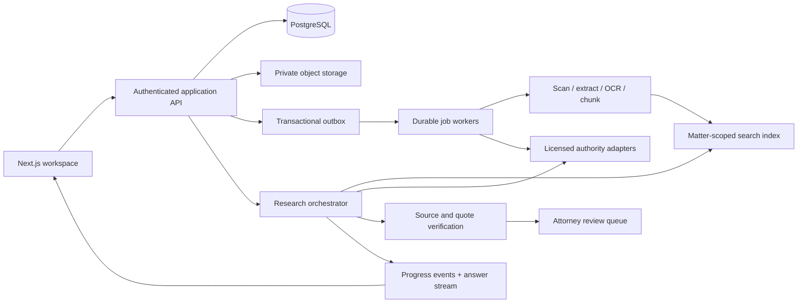

# Casevex backend plan

Status: proposed architecture for discussion, not a deployed backend.

## Product boundary

Casevex is a matter-centered legal research workspace for small litigation firms, beginning with consumer fraud and class action work. The prototype connects the supplied ten screens. Its API is a replaceable, session-scoped in-memory adapter. Research, verification, agents, uploads, and sharing are explicitly simulated. The source material's invented Nexora opinion must never enter the production authority corpus.

The first production milestone is a private single-firm workspace with real sign-in, matter permissions, durable matters/documents/deadlines, and source-grounded research. Billing, autonomous filing, and automatic legal deadline computation are separate workstreams.

## Proposed system



Use a modular application with one relational database first. Keep file extraction and research as background jobs rather than long-lived web requests. PostgreSQL is the proposed system of record; private S3-compatible object storage holds originals and derived artifacts. Begin with full-text search, adding vector retrieval only when benchmark results support it. These are architectural proposals, not vendor selections or provisioned services.

PostgreSQL row-security policies can restrict reads and writes per row. App authorization and database policy should both enforce tenant and matter boundaries, including when a worker or retrieval service runs. Table owners and elevated roles require careful treatment; do not assume enabling RLS alone establishes isolation. [PostgreSQL row security](https://www.postgresql.org/docs/17/ddl-rowsecurity.html)

## Domain model

Every tenant-owned table carries `workspace_id`. Every matter-owned row also carries `matter_id`. Composite foreign keys should enforce that a child belongs to the same workspace as its parent. Cross-matter retrieval is an explicit permission, never an accidental consequence of a shared vector store.

| Domain | Tables | Key data and behavior |
| --- | --- | --- |
| Identity | users, workspaces, memberships, invitations | Auth subject, membership role, invitation hash/expiry, account status. Job title is distinct from authorization role. |
| Matter access | matters, matter_members | Name, docket, court, practice area, party role, summary, archive state, membership override. |
| Documents | documents, document_versions, document_chunks | Immutable version, storage key, checksum, page map, extracted text, processing state. Derived chunks inherit source ACLs. |
| Authority | authorities, authority_versions, authority_treatments | Court, docket, decision date, canonical URL, provider identifier, opinion checksum, treatment status and last checked timestamp. |
| Saved research | matter_authorities, research_threads, messages | Matters reference authorities without copying their provenance. User/assistant messages have immutable ordered IDs. |
| Research execution | research_runs, run_events, answer_sources, verification_checks | Model/provider/prompt version, run status, claim spans, source spans, page/pin cite, check outcome, reviewer. |
| Agents | agent_definitions, agent_versions, matter_agent_assignments | A versioned workflow and policy, not an independent unrestricted actor. Assignment counts derive from rows. |
| Deadlines | events, event_sources, reminders | Date-only vs timestamp, timezone, kind, provenance, attorney confirmation, reminder recipients. |
| Rulings and notices | feed_items, ruling_impacts, notices, notice_reads | Deduplicate provider events; impact is proposed until reviewed; read state belongs to each user. |
| Strategy | strategy_versions, strategy_tasks | Editable working notes with optimistic concurrency and history. |
| Operations | jobs, outbox_events, audit_events, usage_events | Idempotency, retries, trace IDs, token/cost accounting, access and change history. |
| Preferences | user_preferences, notification_preferences, integrations | Display, practice area, timezone, channel settings, encrypted credential references. |

The draft SQL in `schema-draft.sql` captures the core relational boundaries. It is deliberately not a ready-to-run migration: authentication integration, RLS policies, encryption-key management, authority licensing, and retention rules must be implemented and tested before real client data is added.

## Access model

| Capability | Workspace admin | Attorney | Paralegal | Matter viewer |
| --- | --- | --- | --- | --- |
| Manage members/integrations | Yes | No | No | No |
| Read assigned matter | With explicit matter access | Yes | Yes | Yes |
| Edit matter/documents | With matter edit access | Yes | Yes | No |
| Run research | With research permission | Yes | Yes | Optional |
| Verify legal analysis/approve impact | Only if also attorney | Yes | No | No |
| Share/export | Separate permission | If granted | If granted | No |
| Delete workspace or change retention | Explicit administrative workflow | No | No | No |

Workspace admin is not an automatic ethical-wall bypass. Resolve user, workspace membership, matter membership, and capability on every endpoint. Sign-in uses a maintained identity provider; evaluate enterprise SSO/MFA needs before selecting one. The prototype cookie only separates demo sessions and is not authentication.

## API evolution

Retain the prototype's screen-facing endpoints and replace their adapters incrementally. Production requests return a request ID; lists use cursor pagination, stable sorting, and bounded page sizes. Mutations validate a typed schema; optimistic updates use record versions. Standard errors contain `{error:{code,message,requestId,fieldErrors?}}`. Use 401/403/404/409/422/429 consistently. Rate limit by user and workspace.

| Surface | Production API additions |
| --- | --- |
| Dashboard | `GET /api/dashboard` aggregates authorized matter counts, deadlines, activity, and unread impacts; avoid fetching the whole workspace. |
| Matters | Existing GET/POST/PATCH routes plus `POST /matters/:id/archive`, invitations, permission listing, and cursor-based activity. |
| Documents | `POST /documents/upload-intents`, signed upload, `POST /documents/:id/complete`, versioned metadata, processing events, signed downloads. |
| Research | `POST /matters/:id/research-runs` returns 202 + run ID; `GET /research-runs/:id/events` streams SSE; cancel, retry, and persisted result endpoints. |
| Authorities | Search provider and local corpus separately; save authority, fetch opinion, verify citation, record treatment, attorney review. |
| Notices | Per-user read acknowledgments, event deduplication, reviewed impact links, preference-aware email delivery. |
| Calendar | CRUD with version checks; reminders and optional calendar synchronization with external IDs. |
| Agents | Versioned definitions and assignments; run permissions and source-access policy independent from the visible persona. |
| Settings | Separate profile, membership, notification, integration, and security resources. Never allow profile edits to grant authorization roles. |

Use `Idempotency-Key` on run creation, upload finalization, invitations, and event creation. Keep it scoped to tenant/user/action with a payload hash. Store a transactional outbox event alongside the database mutation so work cannot be lost between commit and queue publication.

## Document ingestion

1. Authorize the destination matter and enforce byte/count quotas.
2. Issue a short-lived upload intent to a random object key in a private quarantine prefix.
3. On completion, check checksum, actual type, and size; scan for malware and reject unexpected files. A filename extension is not sufficient validation. Keep untrusted originals outside publicly executable paths. [OWASP file upload guidance](https://cheatsheetseries.owasp.org/cheatsheets/File_Upload_Cheat_Sheet.html)
4. Extract text in a sandboxed worker with page/time/memory limits. OCR scanned pages; preserve page coordinates and extraction confidence.
5. Store immutable versions and page-aware chunks. Add tenant/matter/version filters to every retrieval query.
6. Transition `pending → uploaded → scanning → extracting → indexing → ready`, or a recoverable failure with a useful explanation. Repeated jobs are idempotent by document-version checksum.
7. Publish progress to the document row. Originals are downloaded using short-lived, permission-checked URLs. Deletion propagates to chunks, derived artifacts, indexes, and provider copies subject to retention/hold policy.

## Research and the imported tile animation

The phone prototype's grid becomes a view of run events. Each row represents a source; columns represent `located → fetched → passage matched → checked`. Rose means work in progress, olive means the declared check succeeded, and an explicit labeled failure/review state must be added for blocked checks. Do not color a source olive merely because a model cites it.

Proposed stream events:

```ts
type RunEvent =
  | { type: 'run.started'; runId: string; sequence: number }
  | { type: 'source.progress'; sourceId: string; stage: 'located' | 'fetched' | 'passage_matched' | 'checked'; sequence: number }
  | { type: 'source.failed'; sourceId: string; reason: string; sequence: number }
  | { type: 'answer.delta'; text: string; sequence: number }
  | { type: 'run.completed'; answerId: string; sequence: number }
  | { type: 'run.failed'; retryable: boolean; message: string; sequence: number };
```

Persist events with monotonic sequence numbers; support resume via `Last-Event-ID`. Cancellation must stop provider work where supported and record billed usage already incurred. Stream only safe text; citation identifiers map to server-owned source records, not arbitrary URLs generated by the model.

Retrieval citations are useful evidence pointers, but they do not establish that an opinion exists, that a quoted passage supports a proposition, or that authority remains good law. A tool such as OpenAI file search supplies file citation annotations; application-level legal verification still needs separate provenance, quote matching, and review. [OpenAI file search](https://developers.openai.com/api/docs/guides/tools-file-search)

The answer pipeline should retrieve only authorized source versions, preserve source excerpts, identify unsupported claims, and return uncertainty when evidence is insufficient. Treat retrieved documents as data, never instructions. Record prompt/model versions and use adversarial-document tests. Keep court-rule calculations and proposed legal conclusions reviewable by an attorney.

## Rulings and alerts

Select authority/docket providers only after checking court coverage, update latency, redistribution rights, treatment/citator rights, and price. Do not promise comprehensive negative-treatment checks without a licensed source that supports them. Build provider adapters around normalized IDs and immutable raw snapshots.

Poll or ingest webhooks into a deduplicated feed. Candidate matching uses jurisdiction, matter issues, and cited authorities. A background run proposes `strengthens / weakens / neutral` with source spans and an explanation. Attorney review publishes the impact notice. Store reads per recipient; one person's read should not clear another person's badge.

## Operations and data protection

- Default to private workspaces and deny cross-tenant access in API, storage, search, workers, exports, and SSE.
- Encrypt transport/storage, store service keys in a secret manager, rotate credentials, and avoid logging document content or prompts by default.
- Audit access, exports, invitations, assignment changes, research runs, and review decisions. Limit audit-log access; make integrity tampering detectable.
- Define retention, deletion, legal holds, backup region, and disaster recovery with the firm. Prove a restore before pilot.
- Add structured logs, trace IDs, job-age metrics, provider latency/error rates, ingestion failures, stream disconnects, and cost budgets.
- Tenant-aware caching must include membership/version boundaries. Permission revocation should invalidate access to source text and cached answers.
- Deployment environments and provider accounts must be separated. Sample and production corpora must never share an ingestion namespace.

## Delivery phases and acceptance gates

1. **Foundation and tenancy.** Identity, memberships, matter ACLs, database migrations, audit baseline, CI. Gate: negative authorization tests for every record type and tenant.
2. **Durable workspace.** Matters, documents, deadlines, preferences, notices. Gate: version conflicts, idempotency, upload failure recovery, backup/restore, and record counts reconcile.
3. **Grounded research.** One curated corpus, one provider adapter, jobs, SSE, evidence viewer, citation checks. Gate: a reviewed benchmark set measuring source validity, passage support, abstention, access isolation, latency, and cost; zero invented-citation acceptance in release tests.
4. **Monitoring and collaboration.** Ruling intake, reviewed impacts, invitations, reminders, role-specific workflows. Gate: duplicate events do not duplicate notices; revocation takes effect across APIs and exports.
5. **Pilot hardening.** Retention/hold policy, usage limits, failure drills, accessibility, observability, legal-data contracts. Gate: firm sign-off on data handling, source coverage, and review responsibilities.

## Decisions for the next planning session

- Single-firm pilot only, or invite multiple firms at launch?
- Which courts, jurisdictions, and consumer/class-action workflows are mandatory first?
- Which identity and legal-data providers does the firm already license?
- Must original documents stay in an existing document-management system?
- Required region, retention, legal holds, audit export, and model-provider data controls?
- Should cross-matter research be enabled, and for which roles?
- Who reviews proposed ruling impacts and authority verification?
- What benchmark cases and attorney reviewers define a successful pilot?

No paid infrastructure, accounts, keys, or legal-data subscriptions have been created by this work.
